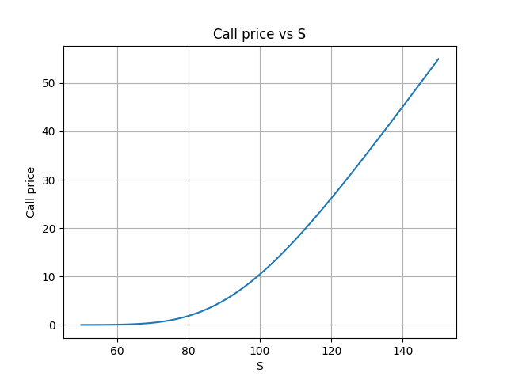

# Black–Scholes Option Pricer (C++)

This project implements the classical Black–Scholes model for pricing European options using modern C++.

The program computes option prices and several key Greeks. It also supports command-line parameters and a grid mode that exports pricing results to CSV for further analysis.

The goal of the project is to explore how quantitative finance models are implemented in real software systems while practicing clean C++ architecture and project structure.


## What the program can do

The implementation currently supports:

- pricing European call and put options
- computing Greeks:
  - delta
  - gamma
  - vega
  - theta
- a C++ command-line interface
- grid mode with CSV export
- Python bindings
- Python plotting scripts for vizualization and analysis

The code uses an object-oriented design where a generic `Option` interface is implemented by `CallOption` and `PutOption` classes.

The project is built with CMake.


## Mathematical model

The Black–Scholes model assumes that the underlying asset follows a lognormal process with constant volatility and interest rate.

The price of a European call option is given by:

C = S N(d1) − K e^(−rT) N(d2)

where

d1 = ( ln(S/K) + (r + σ² / 2) T ) / ( σ √T )

d2 = d1 − σ √T


## Project structure
```bash
black-scholes-fdm/

include/
    bs.hpp

src/
    bs.cpp
    main.cpp

python_bindings/
    bindings.cpp

python_tools/
    plot_from_engine.py
    test_bs_engine


CMakeLists.txt
README.md
```
## Build

Build the project with Cmake:
cmake -S. -B build
cmake --build build

This produces:
1. black_scholes – the C++ executable
2. bs_engine – the Python extension module built through pybind11

## Python usage

A python script imports the compiled module from the build/ directory abd call the C++ engine directly.
Example workflow: 

```python
import sys
import matplotlib.pyplot as plt
from pathlib import Path

project_root = Path(__file__).resolve().parent.parent
build_dir = project_root / "build"
sys.path.insert(0, str(build_dir))

import bs_engine

p = bs_engine.BSParams()
p.S = 100.0
p.K = 100.0
p.r = 0.05
p.sigma = 0.2
p.T = 1.0
```

Then create parameters and request from the C++ engine

## Plotting from python

Current ploting workflow:
1. Python creates arrays of S
2. Python calls the C++ engine on each step
3. Results are stored in Python lists
4. mathplotlib is used to build plots
This keeps:
1. Computation in C++
2. Visualisation in Python

##Example plot


## Usage

Example calculation:
```bash
./black_scholes --S 100 --K 100 --r 0.05 --sigma 0.2 --T 1 --style call
```
Parameters:

S – underlying price  
K – strike price  
r – risk-free rate  
sigma – volatility  
T – time to maturity  
style – call or put


## Grid mode

Example:
```bash
./black_scholes --grid-S 50 150 101 --style call --out prices.csv
```
The program generates a CSV file that can be used for plotting price curves or further analysis.


## Future improvements

Possible extensions:

- cleaner plotting scripts for all greeks
- comparsion of call and put urves
- parameter sweeps over volatility and maturity
- implied volatility solver
- binomial tree model
- Monte Carlo pricing
- finite-difference BS PDE solver
- comparison of analytical and numerical methods


## Why this project

The main idea is to build small research tool by using numerical core in C++, convinient experemintation layer in Python and in future extension to PDE/finite-difference mehods

## Author
Build as learning project in quantitative finance

Vyacheslav  
ETU "LETI"

